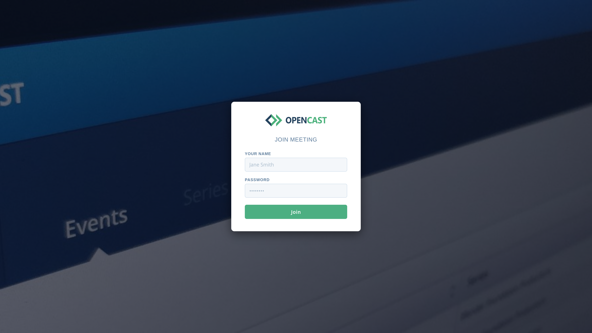

# Opencast Meet

A lightweight BigBlueButton web portal with Opencast integration.



## Overview

Opencast Meet serves a simple login form where visitors enter their name and a
password. On submission the server ensures the configured meeting room exists,
then redirects the browser directly into BigBlueButton as a viewer or
moderator depending on which password was used. It is designed to run behind a
reverse proxy.

## Configuration

All configuration is via environment variables. If a `.env` file is present in
the working directory it is loaded automatically — copy `.env.example` to get
started.

### Required

| Variable                 | Description
| ------------------------ | ----------------------
| `BBB_SERVER_URL`         | BigBlueButton server base URL, e.g. `https://bbb.example.com/bigbluebutton/`
| `BBB_SERVER_SECRET`      | BBB shared API secret
| `APP_USER_PASSWORD`      | Password granting viewer access
| `APP_MODERATOR_PASSWORD` | Password granting moderator access

### Rooms

Rooms are defined with indexed `ROOM_N_*` variables starting at `N = 1`. At
least `ROOM_1_ID` and `ROOM_1_NAME` must be set; the server fails to start
otherwise. When more than one room is configured, a dropdown appears on the
login page.

| Variable                           | Default | Description
| ---------------------------------- | ------- | ---------------------
| `ROOM_N_ID`                        | —       | Stable BBB room identifier (required)
| `ROOM_N_NAME`                      | —       | Room display name shown in the login form (required)
| `ROOM_N_APPEND_DATE`               | `false` | Append today's date to the BBB room name at meeting-create time
| `ROOM_N_RECORD`                    | `false` | Enable recording; also controls whether participants can start/stop recording
| `ROOM_N_WELCOME_MESSAGE`           |         | Message shown inside the meeting
| `ROOM_N_PRE_UPLOADED_PRESENTATION` |         | URL of a pre-loaded presentation

#### Opencast Integration (per room)

| Variable                    | Description
| --------------------------- | -----------------------------
| `ROOM_N_OC_SERIES`          | UUID of the target Opencast series
| `ROOM_N_OC_DC_CREATOR`      | Presenter name for Opencast metadata
| `ROOM_N_OC_ADD_WEBCAMS`     | Include webcam streams in the recording (`true`/`false`)
| `ROOM_N_OC_ACL_READ_ROLES`  | Comma-separated roles with read access
| `ROOM_N_OC_ACL_WRITE_ROLES` | Comma-separated roles with write access

### Server

| Variable           | Default          | Description
| ------------------ | ---------------- | -------------------
| `APP_LISTEN_ADDR`  | `127.0.0.1:8080` | HTTP listen address
| `APP_FRONTEND_URL` |                  | Used as BBB  redirect URL
| `ENABLE_REAL_IP`   | `false`          | Use the first `X-Forwarded-For` entry as client IP for rate limiting; see [Reverse proxy](#reverse-proxy)
| `METRICS_USERNAME` |                  | Username for `/metrics` Basic Auth (must be paired with `METRICS_PASSWORD`)
| `METRICS_PASSWORD` |                  | Password for `/metrics` Basic Auth (must be paired with `METRICS_USERNAME`)

### Reverse proxy

Login attempts with a wrong password are rate limited per client IP. Behind a
reverse proxy all clients share the proxy's address unless `ENABLE_REAL_IP` is
set, in which case the first entry of `X-Forwarded-For` is used instead.

Only enable this when the outermost proxy replaces any client-supplied
`X-Forwarded-For` header, otherwise clients can spoof their IP and bypass the
rate limit:

- **Caddy** does this by default (unless the client is listed in
  `trusted_proxies`).
- **nginx** with `proxy_add_x_forwarded_for` appends to the client's header.
  Use `proxy_set_header X-Forwarded-For $remote_addr;` on the outermost proxy,
  or the `realip` module with `set_real_ip_from`.

Chained proxies are fine as long as the outermost one follows this rule.

## Running

### Local

```sh
cp .env.example .env
# edit .env
go run .
```

Then open <http://localhost:8080>.

### Docker

```yaml
services:
  opencast-meet:
    image: ghcr.io/virtuos/opencast-meet:latest
    ports:
      - "8080:8080"
    env_file: .env
```
